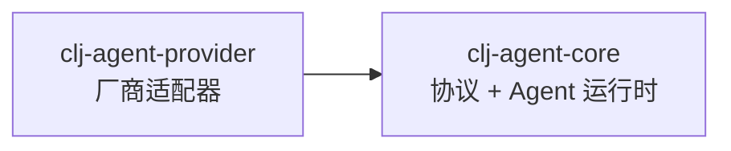

# clj-agent 多模块项目

## 模块结构

clj-agent 采用**依赖倒置(DIP)**的分层:**Core 定义协议(端口)+ chat-client 原语;Provider 实现协议(适配器);Client 是 Agent 运行时(循环/记忆/门面)。** 任何实现了 `im.ttalk.agent.model/ILLMProvider` 的 jar 都能作为 provider 注入 agent。三层之外还有一个**可选的最外层** `clj-agent-agui`——它让 run 的寿命不再由 HTTP 请求的寿命决定(断线重连 / 跨请求 stop 与 resume),并把事件流按 AG-UI 编码。

```
clj-agent/
├── modules/
│   ├── clj-http/      # HTTP 传输(java.net.http 唯一入口);零依赖,provider / mcp / tools 共用
│   ├── clj-agent-core/      # 协议(端口) + chat-client 原语;零依赖
│   ├── clj-agent-client/    # Agent 运行时(client/react/memory/subagent),依赖 core
│   ├── clj-agent-provider/  # 各厂商适配器(实现协议),依赖 core
│   ├── clj-agent-mcp/       # (可选)MCP 协议两侧(client + server),只依赖 http
│   ├── clj-agent-agui/      # (可选)Agent Runtime 后台机制 + AG-UI 协议,依赖 core + client + mcp
│   ├── clj-agent-tools/     # (可选)编码类 agent 工具(文件 / 补丁 / exec / web_fetch),依赖 core + http
│   ├── clj-agent-server/    # (可选)AG-UI 与 MCP 的 HTTP 服务端,纯 Ring 处理器;依赖 agui + mcp + http + ring-core
│   └── clj-agent-server-jetty/ # (可选)clj-agent-server 的缺省 adapter:Jetty 12 宿主
├── bb.edn                   # 开发任务(bb test / bb jar / bb release …)
├── build.clj                # 三模块统一构建发布(tools.build)
└── deps.edn                 # 根配置(开发/测试一次性加载全部模块)
```

依赖方向:**Provider → Core ← Client ← AGUI**(实现与运行时各自依赖抽象,互不依赖;agui 挂在 client 外面,没人依赖它)。应用层在运行时构造一个 provider 注入 agent。

`clj-agent-mcp` 站在这张图**外面**:它不依赖 agent 侧的任何模块(连 core 都不,只用零依赖的 http 传输),因为 MCP 是一个独立协议,
它产出的工具是**普通 map**——那是 clj-agent 的内联工具约定,不需要 require 任何东西就能满足。
agui 依赖它,只是为了 MCP Apps 那半边(activity 事件 + UI 代理)。

---

## 模块说明

### 1. clj-agent-core — 协议 + chat-client 原语

**职责**: 定义 LLM 抽象契约(端口)与 chat-client 编排原语。**不依赖任何 provider 实现,对记忆/循环零感知**。

**契约 / 端口**(`im.ttalk.agent.model.*`):
- `im.ttalk.agent.model` — `ILLMProvider` 协议,以**中立消息**为边界（**一次 HTTP 往返**,不含重试）
- `im.ttalk.agent.model.message` / `.request` / `.response` / `.error` — 中立消息、`ChatRequest`、`ChatResponse`、错误
- `im.ttalk.agent.chat-model` — `IChatModel` 协议（≈ Spring AI `ChatModel`）+ `DefaultChatModel` / `FnChatModel`；**一次逻辑调用**:选项合并 → 重试 → 归一化
- `im.ttalk.agent.retry` — 通用重试（判据取自 canonical error 的 `:retryable?`）,零依赖

**ChatClient 原语**:
- `im.ttalk.agent` - **Facade 入口**（≈ beamai `beamai.erl`）:常用 API 一个地方找得到,一行转发
- `im.ttalk.agent.chat-client` - ChatClient（≈ Spring AI `ChatClient`）:`build-chat-client` + 三个 invoke 原语
- `im.ttalk.agent.tool-registry` - 工具声明表:装配期建表/校验 + 运行期 8 个查询
- `im.ttalk.agent.tool` - deftool 宏（≈ `ToolCallback`）
- `im.ttalk.agent.filter` - 洋葱链执行器与装配期预编译（≈ `CallAdvisorChain`）；四条 around 链 `:chat`/`:tool`/`:iteration`/`:turn` + `:token-xform`；`ChatClientRequest`/`ChatClientResponse`
- `im.ttalk.agent.context` - 请求级上下文
- `im.ttalk.agent.streaming` - 流式取消令牌

**依赖**: 无（纯 Clojure）

---

### 1.5 clj-agent-client — Agent 运行时

**职责**: 在 core 原语之上构建 Agent 运行时（2026-07 自 core 下沉，命名空间不变）。

- `im.ttalk.agent.simple-agent` - 高级 Agent API（有状态对话 + 工具循环 + pause/resume）
- `im.ttalk.agent.react` - ReAct 工具调用循环
- `im.ttalk.agent.memory` / `.memory.sqlite` - ChatMemory
- `im.ttalk.agent.filter.memory` - 记忆 filter（≈ `MessageChatMemoryAdvisor`）
- `im.ttalk.agent.callbacks` - 生命周期回调
- `im.ttalk.agent.subagent.*` - 子 agent 体系
- `im.ttalk.agent.common` - 共享 ChatClient 构建

**依赖**: `clj-agent-core`; timbre, next.jdbc, sqlite-jdbc

---

### 1.6 clj-agent-agui — Agent Runtime 后台机制 + AG-UI 协议(可选)

**职责**: 让 **run 的寿命不再由 HTTP 请求的寿命决定**——会话注册表 + 有界事件
缓冲 + 会话级单调 `:seq` 偏移续传 + 跨请求 stop/resume;再把中立事件按 AG-UI
编码,于是 CopilotKit 之类的前端可以**直连 Clojure**,不需要中间那个 Node runtime。

- `im.ttalk.agent.agui.runtime` - 会话注册表 + run 生命周期 + 订阅(**中立,无 AG-UI 概念**)
- `im.ttalk.agent.agui.event` - 中立事件模型 + 每 run 的发射器(`:seq` 无洞 / 开块补关 / 终态唯一)
- `im.ttalk.agent.agui.emit` - 接线:`on-token` + `:iteration` filter + `:on-llm-result` → 事件
- `im.ttalk.agent.agui.codec` - 中立事件 ⇄ AG-UI 事件、中立消息 → AG-UI 消息、`RunAgentInput` 解析
- `im.ttalk.agent.agui.tools` - AG-UI 前端工具(client-side tool)→ 内联工具 + gate

**零 web 依赖**(`docs/design-principles.md` §2):订阅是回调,本模块不认识
Request/Response/SSE 帧。真路由在 `examples/copilotkit/`。

**依赖**: `clj-agent-core` + `clj-agent-client`; cheshire, timbre
(设计与判据见 `docs/agent-runtime-design.md`)

---

### 1.7 clj-agent-mcp — MCP 协议两侧(可选)

**职责**: 按规范 [`2026-07-28`](https://modelcontextprotocol.io/specification/2026-07-28)
实现 MCP 的 **client 与 server 两侧**,并向下兼容 `initialize` 握手时代的老实现
(**双时代**)。传输:Streamable HTTP + stdio。

- `im.ttalk.agent.mcp.protocol` - 纯数据:方法名 / `_meta` 键 / 错误码 / 版本 / 信封,**零 I/O**
- `im.ttalk.agent.mcp.transport` - Streamable HTTP + stdio;`(fn [msg] resp)` 也是合法传输
- `im.ttalk.agent.mcp.client` - 判时代 + `tools/*` `resources/*` `prompts/*` + 翻页
- `im.ttalk.agent.mcp.tools` - MCP 工具 → clj-agent 内联工具
- `im.ttalk.agent.mcp.server` - `handle-message`(纯函数)+ stdio 循环

2026-07-28 是一次**大改版**:删掉 `initialize` 握手、HTTP 不再有会话、版本与能力改成
**每条请求自带**(`params._meta`)、结果多 `resultType`、roots/sampling/logging 全部
deprecated。所以这不是升级而是重写——原来那份 legacy 实现在 `agui/mcp.clj` 里,现已
瘦身为只剩 MCP Apps 的前端约定。

**零 web 服务端依赖**:HTTP 客户端走 `clj-http`(JDK `java.net.http`);服务端只给纯函数,
接到哪个 web 框架上是调用方的事(示例见 `examples/mcp/server_example.clj`)。

**依赖**: `clj-http`; cheshire, timbre
(设计与判据见 `docs/mcp-module-design.md`)

---

### 1.8 clj-agent-tools — 编码类 agent 工具(可选)

**职责**: 一行 `(tools/workspace-tools {:root ".." :groups #{:files :edit}})` 拿到一组绑定好工作区的
`deftool` 工具 var(`read_file` / `write_file` / `edit_file` / `apply_patch` / `list_dir` / `glob` / `grep` /
`delete_path` / `exec` / `exec_command` / `write_stdin` / `web_fetch` / `skill` / `notes_*`)。所有碰文件的工具先过
**工作区路径策略**(根 / 只读根 / 受保护名 / 符号链接逃逸),写类工具过**读写新鲜度闸**与**「不更糟」语法闸**,
敏感工具用 `{:sensitive true}` 标注——现有 `approval-filter` / `:on-pause` 原样生效。

- `im.ttalk.agent.tools` - 门面(`workspace-tools` / `preview` 审批预览 / `close!`)
- `im.ttalk.agent.tools.{workspace,files,edit,patch,exec,web,skill,notes,syntax,freshness,text,walk}` - 见模块 README

**为什么不进 core**: core 零依赖零 I/O;这些工具碰文件系统、起子进程、出网。**只依赖 core**(不依赖 client),
工具不认识 react 循环 / memory / pause。

**依赖**: `clj-agent-core`, `clj-http`(web_fetch 的传输); cheshire(XML / 进程走 JDK)
(设计与判据见 `designs/tools-module.md`;Codex 署名见 `clj-agent-tools/THIRD-PARTY-NOTICES.md`)

---

### 1.9 clj-http — HTTP 传输

**职责**: JDK `java.net.http` 之上**唯一**一处把 Clojure map 变成 `HttpRequest` 的地方——client 构造、
同步 / `CompletableFuture` 异步请求、按行真流式(首字节 / 空闲 watchdog)、大小写不敏感的头工具。
缺省 Content-Type、HTTP/1.1、响应头形状(小写名 ⇒ 串向量)由它保证,不靠每个调用方记得。

- `im.ttalk.http` - `client` / `request` / `request-async` / `stream-lines` / 头工具
- `im.ttalk.http.{sse,proxy,failure,date}` - SSE 分帧 / 环境变量代理 / 网络错分类 / HTTP 日期与 Retry-After
  (移植自 Keelson `jvm/modules/clj-net`)

**零依赖**: 不依赖 core(deferred 就是 `CompletableFuture`)、不依赖 cheshire(JSON 是调用方的事)、不打日志。
canonical error、业务码、重试判定留在 provider。

**依赖**: 无
(设计与判据见 `designs/http-module.md`)

---

### 1.10 clj-agent-server / clj-agent-server-jetty — AG-UI 与 MCP 的 HTTP 服务端(可选)

**职责**: 把 clj-agent-agui 的 runtime 与 clj-agent-mcp 的服务端纯函数接到 HTTP 上。**服务端协议就是 Ring SPEC**:
`clj-agent-server` 全是 Ring 处理器 / 中间件(路由、本机访问守卫、请求体上限、SSE、AG-UI 路由、MCP Streamable HTTP 端点),
不认识任何具体服务端;`clj-agent-server-jetty` 是缺省 adapter(Jetty 12 宿主)。换 http-kit / Undertow = 把同一个 Ring 处理器
交给它们,外加 `im.ttalk.agent.server.adapter.*` 的流式垫片(这两家不实现 SPEC 的流式正文,实测见设计 §1)。

- `im.ttalk.agent.server.{routing,guard,http,sse,strings}` - 通用的 Ring 层(移植自 Keelson clj-net-server)
- `im.ttalk.agent.server.agui` 与 `.agui.*` - AG-UI 路由(移植自 Keelson clj-agui-server)
- `im.ttalk.agent.server.mcp` - MCP Streamable HTTP 端点
- `im.ttalk.agent.server.adapter.{http-kit,undertow}` - adapter 侧垫片
- `im.ttalk.agent.server.jetty` - Jetty 12 宿主(在 clj-agent-server-jetty 里)

**为什么单独成模块**: design-principles §2.2——web 依赖不进核心,适配器做成可选模块。Ring 只进 clj-agent-server,Jetty 只进
clj-agent-server-jetty。

**依赖**: `clj-agent-agui`、`clj-agent-mcp`、`clj-http`; ring-core, cheshire(jetty 模块另加 ring-jetty-adapter)
(设计与判据见 `designs/server-module.md`;示例 `examples/server/demo.clj`)

---

### 2. clj-agent-provider — 厂商适配器

**职责**: 实现 `im.ttalk.agent.model/ILLMProvider`;`call-llm` 收**中立消息**、内部转各厂商 wire 格式再请求 API。

**包含**（`im.ttalk.agent.provider.*`）:
- `im.ttalk.agent.provider.{openai,anthropic,zhipu,ollama,gemini,mistral,deepseek,minimax,dashscope,openai-compat-provider,mock}` - 各 provider 实现
- `im.ttalk.agent.provider.common.{base,openai-compat,cache,response-parser}` - 辅助层：provider 基座/OpenAI 协议层/Anthropic 缓存策略/响应解析
- `im.ttalk.agent.provider.{wire,schema,stream}.*` - wire 格式 / 工具 schema / 流式解析（provider 内部）
- `im.ttalk.agent.provider.http.{client,retry}` - HTTP 门面(传输在 clj-http) / 重试与错误分类
- `im.ttalk.agent.provider.factory.*` - Provider 注册/配置/创建
- `im.ttalk.agent.provider.api` - Provider 统一门面

**依赖**: `clj-agent-core`(协议/契约), `clj-http`(HTTP 传输,零依赖), cheshire, timbre

---

## 使用方法

### 方式 1: 根目录开发（推荐）

```bash
clojure -M:test          # 运行所有测试
```

### 方式 2: 单模块开发

```bash
cd modules/clj-agent-core
clojure -M:dev
clojure -M:test
```

---

## 依赖关系



> 第三方只需依赖 `clj-agent-core`、实现 `im.ttalk.agent.model/ILLMProvider`，即可作为 provider 被 agent 使用。
